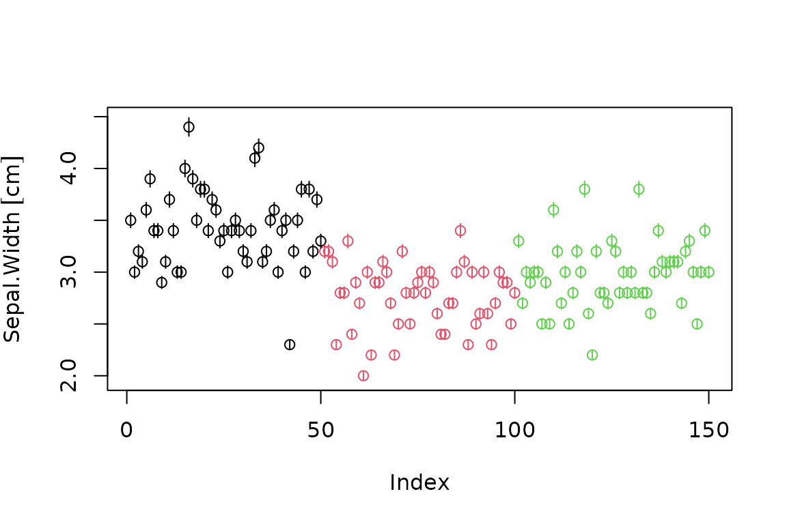
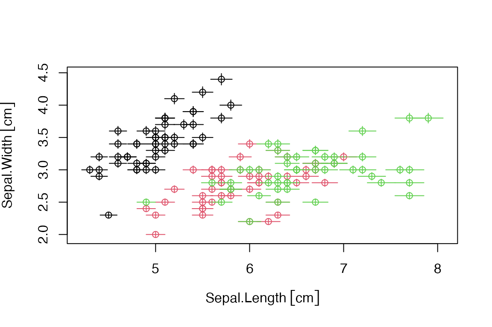
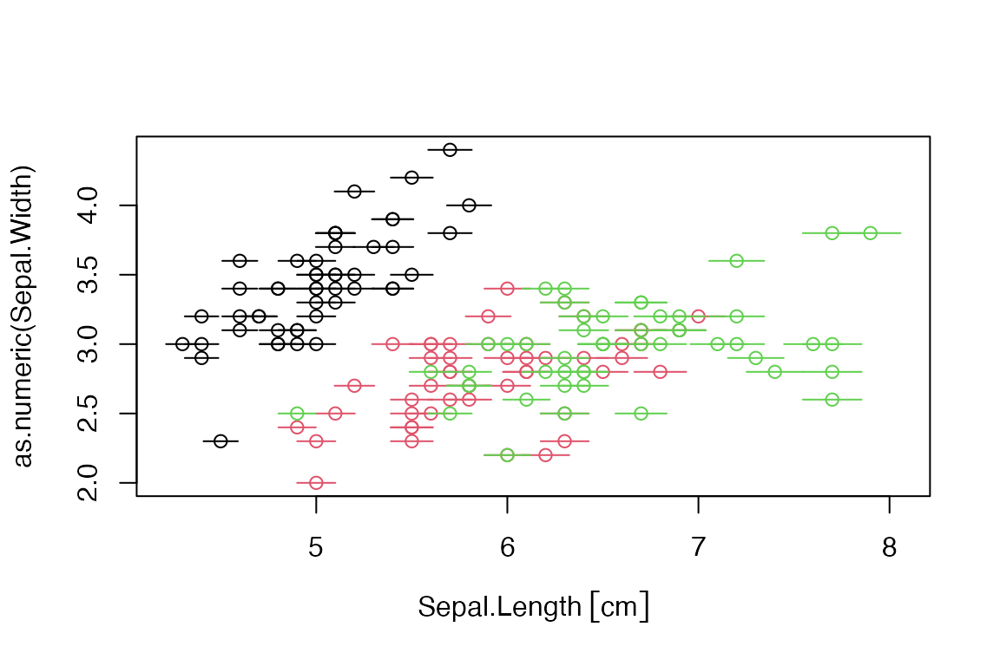
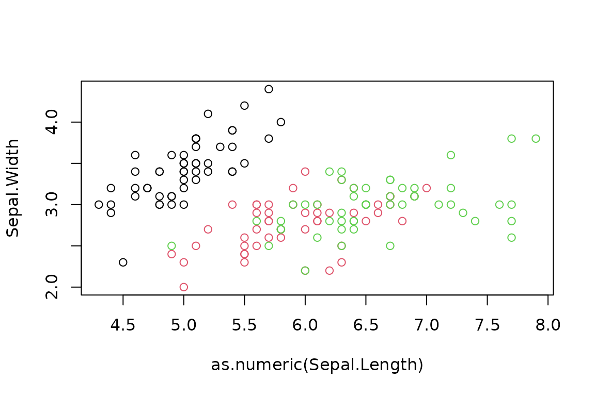
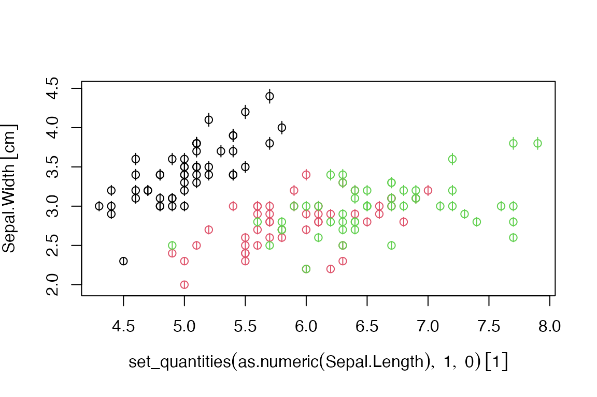
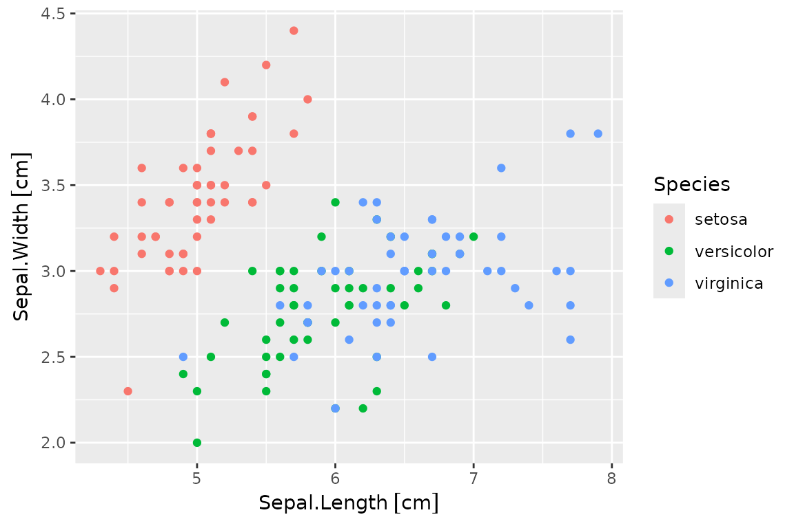
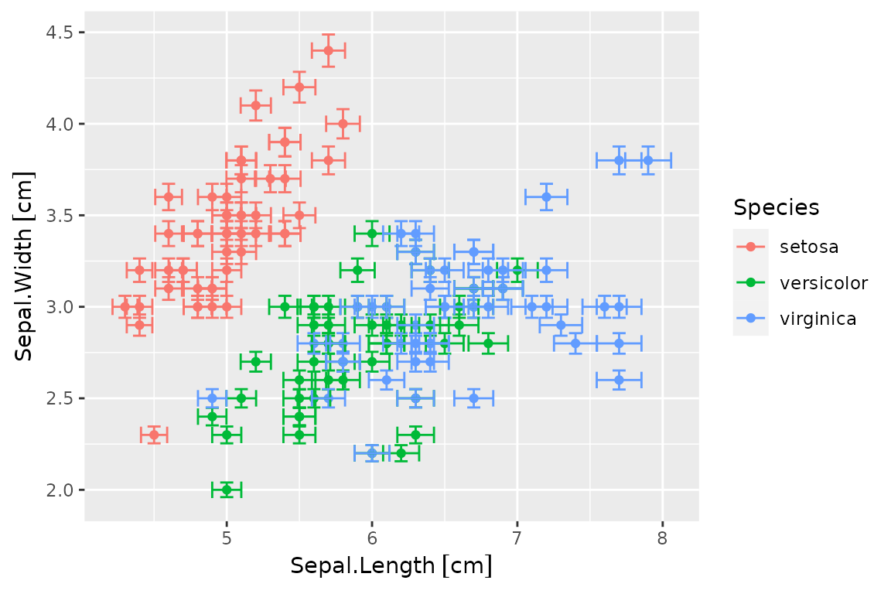
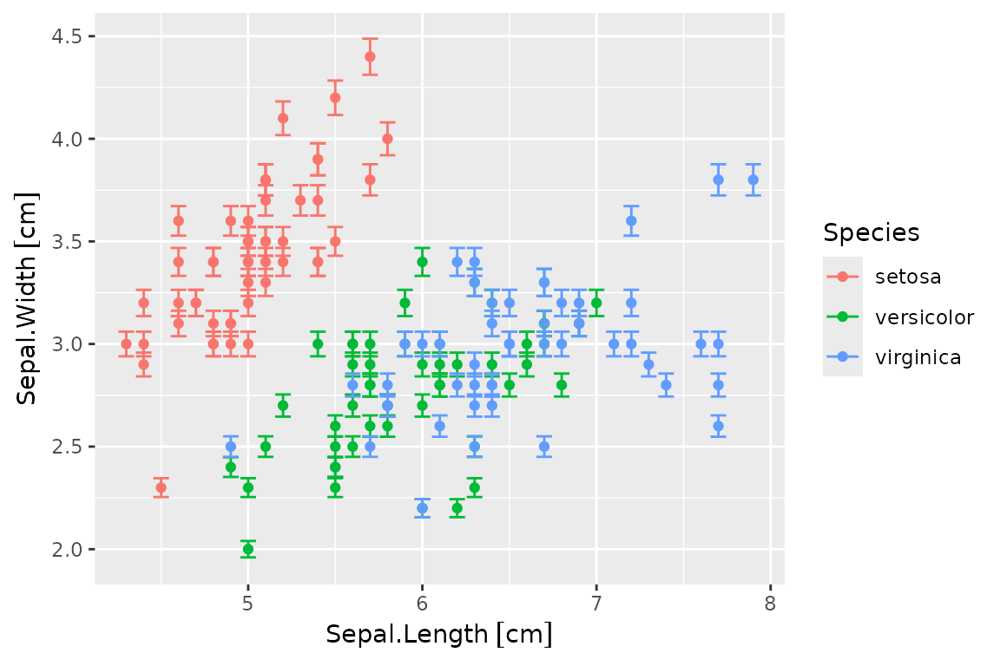
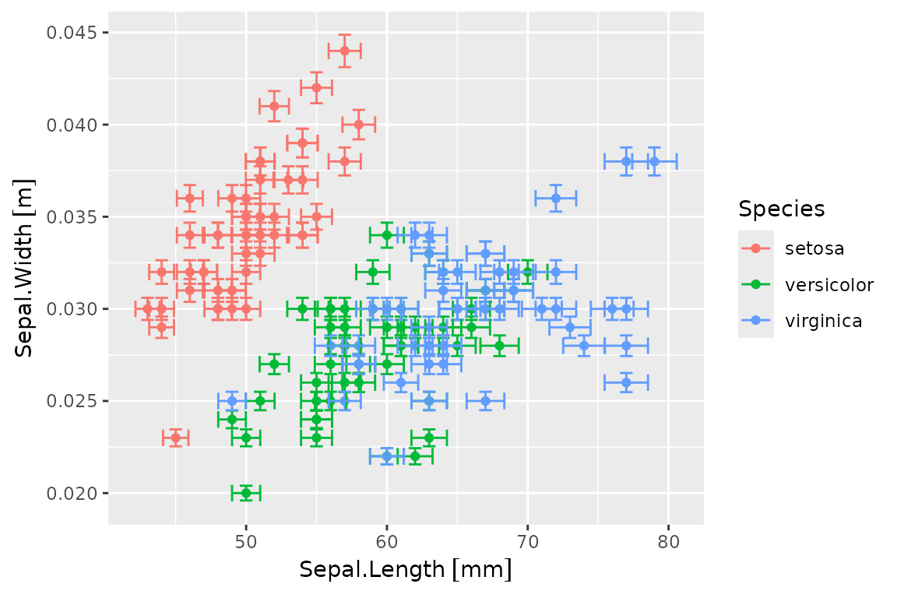

# A Guide to Working with Quantities

## Introduction

This document intends to be a guide on how to work with quantities data
(magnitudes with units and/or uncertainty) in two distinct workflows: R
*base* and the so-called [*tidyverse*](https://tidyverse.org/). Units
and errors (and, by extension, quantities) objects essentially are
numeric vectors, arrays and matrices with associated metadata. This
metadata is not always compatible with some functions, and thus we here
explore the most common operations in data wrangling (subsetting,
ordering, transformations, aggregations…) to identify potential issues
and propose possible workarounds.

Let us consider the traditional `iris` data set for this exercise.
According to its documentation,

> `iris` is a data frame with 150 cases (rows) and 5 variables (columns)
> named `Sepal.Length`, `Sepal.Width`, `Petal.Length`, `Petal.Width`,
> and `Species`.

And values are provided in centimeters. If we consider, for instance, a
2% of uncertainty, the first step is to define proper quantities. Then
we will work on the resulting data frame for the rest of this article.

``` r

library(quantities)
#> Loading required package: units
#> udunits database from /usr/share/xml/udunits/udunits2.xml
#> Loading required package: errors

iris.q <- iris
for (i in 1:4)
  quantities(iris.q[,i]) <- list("cm", iris.q[,i] * 0.02)
head(iris.q)
#>   Sepal.Length  Sepal.Width Petal.Length   Petal.Width Species
#> 1  5.1(1) [cm] 3.50(7) [cm] 1.40(3) [cm] 0.200(4) [cm]  setosa
#> 2  4.9(1) [cm] 3.00(6) [cm] 1.40(3) [cm] 0.200(4) [cm]  setosa
#> 3 4.70(9) [cm] 3.20(6) [cm] 1.30(3) [cm] 0.200(4) [cm]  setosa
#> 4 4.60(9) [cm] 3.10(6) [cm] 1.50(3) [cm] 0.200(4) [cm]  setosa
#> 5  5.0(1) [cm] 3.60(7) [cm] 1.40(3) [cm] 0.200(4) [cm]  setosa
#> 6  5.4(1) [cm] 3.90(8) [cm] 1.70(3) [cm] 0.400(8) [cm]  setosa
```

Note that, throughout this document, and unless otherwise stated, we
will talk about *quantities objects* as a shortcut for *quantities,
units and errors objects*.

## R Base

In this section, we consider all the methods and functions included in
the default packages, i.e., those that are automatically installed along
with any R distribution:

``` r

rownames(installed.packages(priority="base"))
```

    #>  [1] "base"      "compiler"  "datasets"  "graphics"  "grDevices" "grid"     
    #>  [7] "methods"   "parallel"  "splines"   "stats"     "stats4"    "tcltk"    
    #> [13] "tools"     "utils"

### Row Subsetting

Quantities objects have all the subsetting methods defined (`[`, `[[`,
`[<-`, `[[<-`). Therefore they can be used in the same way as with plain
numeric vectors, and in conjunction with `which` and other functions to
perform subsetting. The `subset` function is very handy too and achieves
the same result:

``` r

iris.q[which(iris.q$Sepal.Length > set_quantities(75, mm)), ]
#>     Sepal.Length  Sepal.Width Petal.Length  Petal.Width   Species
#> 106  7.6(2) [cm] 3.00(6) [cm]  6.6(1) [cm] 2.10(4) [cm] virginica
#> 118  7.7(2) [cm] 3.80(8) [cm]  6.7(1) [cm] 2.20(4) [cm] virginica
#> 119  7.7(2) [cm] 2.60(5) [cm]  6.9(1) [cm] 2.30(5) [cm] virginica
#> 123  7.7(2) [cm] 2.80(6) [cm]  6.7(1) [cm] 2.00(4) [cm] virginica
#> 132  7.9(2) [cm] 3.80(8) [cm]  6.4(1) [cm] 2.00(4) [cm] virginica
#> 136  7.7(2) [cm] 3.00(6) [cm]  6.1(1) [cm] 2.30(5) [cm] virginica
subset(iris.q, Sepal.Length > set_quantities(75, mm))
#>     Sepal.Length  Sepal.Width Petal.Length  Petal.Width   Species
#> 106  7.6(2) [cm] 3.00(6) [cm]  6.6(1) [cm] 2.10(4) [cm] virginica
#> 118  7.7(2) [cm] 3.80(8) [cm]  6.7(1) [cm] 2.20(4) [cm] virginica
#> 119  7.7(2) [cm] 2.60(5) [cm]  6.9(1) [cm] 2.30(5) [cm] virginica
#> 123  7.7(2) [cm] 2.80(6) [cm]  6.7(1) [cm] 2.00(4) [cm] virginica
#> 132  7.9(2) [cm] 3.80(8) [cm]  6.4(1) [cm] 2.00(4) [cm] virginica
#> 136  7.7(2) [cm] 3.00(6) [cm]  6.1(1) [cm] 2.30(5) [cm] virginica
```

Note that another quantities object is defined for the comparison. This
is needed because different units are incomparable. Also note that the
first line throws a warning telling us that the uncertainty was dropped
for this operation. This kind of warning is thrown once, and this is why
`subset` succeeds silently.

### Row Ordering

The `sort` function, as its name suggests, *sorts* vectors, and it is
compatible with quantities:

``` r

iris.q$Sepal.Length[1:5]
#> Units: [cm]
#> Errors: 0.102 0.098 0.094 0.092 0.100
#> [1] 5.1 4.9 4.7 4.6 5.0
sort(iris.q$Sepal.Length[1:5])
#> Units: [cm]
#> Errors: 0.092 0.094 0.098 0.100 0.102
#> [1] 4.6 4.7 4.9 5.0 5.1
```

More generally, the `order` function can be used for data frame
ordering:

``` r

head(iris.q[order(iris.q$Sepal.Length), ])
#>    Sepal.Length  Sepal.Width Petal.Length   Petal.Width Species
#> 14 4.30(9) [cm] 3.00(6) [cm] 1.10(2) [cm] 0.100(2) [cm]  setosa
#> 9  4.40(9) [cm] 2.90(6) [cm] 1.40(3) [cm] 0.200(4) [cm]  setosa
#> 39 4.40(9) [cm] 3.00(6) [cm] 1.30(3) [cm] 0.200(4) [cm]  setosa
#> 43 4.40(9) [cm] 3.20(6) [cm] 1.30(3) [cm] 0.200(4) [cm]  setosa
#> 42 4.50(9) [cm] 2.30(5) [cm] 1.30(3) [cm] 0.300(6) [cm]  setosa
#> 4  4.60(9) [cm] 3.10(6) [cm] 1.50(3) [cm] 0.200(4) [cm]  setosa
```

### Column Transformation

The `transform` function is able to modify variables in a data frame or
to create new ones. The `within` function provides a similar but more
flexible approach though. Both are fully compatible with quantities:

``` r

head(within(iris.q, {
  Sepal.Area <- Sepal.Length * Sepal.Width
  Petal.Area <- Petal.Length * Petal.Width
  rm(Sepal.Length, Sepal.Width, Petal.Length, Petal.Width)
}))
#>   Species      Petal.Area     Sepal.Area
#> 1  setosa 0.280(8) [cm^2] 17.8(5) [cm^2]
#> 2  setosa 0.280(8) [cm^2] 14.7(4) [cm^2]
#> 3  setosa 0.260(7) [cm^2] 15.0(4) [cm^2]
#> 4  setosa 0.300(8) [cm^2] 14.3(4) [cm^2]
#> 5  setosa 0.280(8) [cm^2] 18.0(5) [cm^2]
#> 6  setosa  0.68(2) [cm^2] 21.1(6) [cm^2]
```

### Row Aggregation

Row aggregation is the process of summarising data based on some
grouping variable(s). There are several ways of working with data split
by factors in R base, and, although they tend to preserve classes, they
are generally not very kind to other metadata (i.e., attributes) by
default.

In the following example, the average `Sepal.Length` is computed per
`Species`, but the metadata gets dropped:

``` r

tapply(iris.q$Sepal.Length, iris.q$Species, mean)
#>     setosa versicolor  virginica 
#>      5.006      5.936      6.588
```

Many of these functions include a `simplify` parameter which, if set to
`FALSE`, preserves quantities metadata:

``` r

(sepal.length.agg <- 
   tapply(iris.q$Sepal.Length, iris.q$Species, mean, simplify=FALSE))
#> $setosa
#> 5.0(1) [cm]
#> 
#> $versicolor
#> 5.9(1) [cm]
#> 
#> $virginica
#> 6.6(1) [cm]
```

The only drawback is that the result is a list, and such a list must be
unlisted with care, otherwise, metadata gets dropped again:

``` r

# drops quantities
unlist(sepal.length.agg)
#>     setosa versicolor  virginica 
#>      5.006      5.936      6.588

# preserves quantities
do.call(c, sepal.length.agg)
#> Units: [cm]
#> Errors: 0.10012 0.11872 0.13176
#>     setosa versicolor  virginica 
#>      5.006      5.936      6.588
```

The `by` function is an object-oriented wrapper for `tapply` applied to
data frames which also provides a `simplify` parameter. A more
convenient way of working with summary statistics is the `aggregate`
generic, from the `stats` namespace. Although there is a
`aggregate.data.frame` method, there is a more intuitive interface to it
through the `aggregate.formula` method. Again, it is necessary to set
`simplify=FALSE` to keep quantities:

``` r

(iris.q.agg <- aggregate(. ~ Species, data = iris.q, mean, simplify=FALSE))
#>      Species Sepal.Length  Sepal.Width Petal.Length  Petal.Width
#> 1     setosa  5.0(1) [cm] 3.43(7) [cm] 1.46(3) [cm] 0.25(1) [cm]
#> 2 versicolor  5.9(1) [cm] 2.77(6) [cm] 4.26(9) [cm] 1.33(3) [cm]
#> 3  virginica  6.6(1) [cm] 2.97(6) [cm]  5.6(1) [cm] 2.03(4) [cm]
```

Apparently, the output has no metadata associated, but what really
happens is that the resulting columns are lists:

``` r

class(iris.q.agg$Sepal.Length)
#> [1] "list"
```

Therefore, as in the `tapply`/`by` case, they must be unlisted with care
to still preserve the metadata:

``` r

unlist_quantities <- function(x) {
  stopifnot(is.list(x) || is.data.frame(x))
  
  unlist <- function(x) {
    if (any(class(x[[1]]) %in% c("quantities", "units", "errors")))
      do.call(c, x)
    else x
  }
  
  if (is.data.frame(x))
    as.data.frame(lapply(x, unlist), col.names=colnames(x))
  else unlist(x)
}

unlist_quantities(iris.q.agg)
#>      Species Sepal.Length  Sepal.Width Petal.Length  Petal.Width
#> 1     setosa  5.0(1) [cm] 3.43(7) [cm] 1.46(3) [cm] 0.25(1) [cm]
#> 2 versicolor  5.9(1) [cm] 2.77(6) [cm] 4.26(9) [cm] 1.33(3) [cm]
#> 3  virginica  6.6(1) [cm] 2.97(6) [cm]  5.6(1) [cm] 2.03(4) [cm]
```

And this method works for the `tapply`/`by` case too:

``` r

unlist_quantities(sepal.length.agg)
#> Units: [cm]
#> Errors: 0.10012 0.11872 0.13176
#>     setosa versicolor  virginica 
#>      5.006      5.936      6.588
```

### Column Joining

Joining data frames by common columns can done with the `merge` generic.
Such operations are based on appending columns, which may be subset or
replicated to fit the length of the merged observations. Therefore,
quantities should be preserved in all cases. In the following example,
we generate a data frame with the height per species and then merge it
with the main data set:

``` r

height <- data.frame(
  Height = set_quantities(c(55, 60, 45), cm, c(45, 30, 35)),
  Species = c("setosa", "virginica", "versicolor")
)

head(merge(iris.q, height))
#>   Species Sepal.Length  Sepal.Width Petal.Length   Petal.Width      Height
#> 1  setosa  5.1(1) [cm] 3.50(7) [cm] 1.40(3) [cm] 0.200(4) [cm] 60(40) [cm]
#> 2  setosa  4.9(1) [cm] 3.00(6) [cm] 1.40(3) [cm] 0.200(4) [cm] 60(40) [cm]
#> 3  setosa 4.70(9) [cm] 3.20(6) [cm] 1.30(3) [cm] 0.200(4) [cm] 60(40) [cm]
#> 4  setosa 4.60(9) [cm] 3.10(6) [cm] 1.50(3) [cm] 0.200(4) [cm] 60(40) [cm]
#> 5  setosa  5.0(1) [cm] 3.60(7) [cm] 1.40(3) [cm] 0.200(4) [cm] 60(40) [cm]
#> 6  setosa  5.4(1) [cm] 3.90(8) [cm] 1.70(3) [cm] 0.400(8) [cm] 60(40) [cm]
```

### (Un)Pivoting

The `reshape` function, from the `stats` namespace, provides an
interface for both pivoting and unpivoting (i.e., *tidyfying* data). In
the case of the `iris` data set, we would say that it is in the *wide
format*, because each row has more than one observation.

This function has a quite peculiar nomenclature. First of all, the
unpivoting operation is accessed by providing the argument
`direction="long"`. We need to define the `varying` columns (columns to
unpivot), as character or indices, and they are unpivoted based on their
names. By default, the separator `sep="."` is used, which means that
`Sepal.Width` will be broken down into `Sepal` and `Width`, and the
former will be unpivoted with the latter as grouping variable. We can
specify the name of the grouping variable with the `timevar` argument.

Putting everything together, this is how to unpivot the data set by the
dimension (which we will call it `dim`) of the petal/sepal:

``` r

long.1 <- reshape(iris.q, varying=1:4, timevar="dim", idvar="dim.id", direction="long")
head(long.1)
#>          Species    dim        Sepal        Petal dim.id
#> 1.Length  setosa Length  5.1(1) [cm] 1.40(3) [cm]      1
#> 2.Length  setosa Length  4.9(1) [cm] 1.40(3) [cm]      2
#> 3.Length  setosa Length 4.70(9) [cm] 1.30(3) [cm]      3
#> 4.Length  setosa Length 4.60(9) [cm] 1.50(3) [cm]      4
#> 5.Length  setosa Length  5.0(1) [cm] 1.40(3) [cm]      5
#> 6.Length  setosa Length  5.4(1) [cm] 1.70(3) [cm]      6
```

It can be noted that the unpivoting also generates an index to indentify
multiple records from the same group. We have changed the name of that
identifier to `dim.id` (just `id` by default).

We can further unpivot sepal and petal as the `part` of the flower.
First, we need to prepend a common identifier to columns 3 and 4, which
are to be unpivoted:

``` r

names(long.1)[3:4] <- paste0("value.", names(long.1)[3:4])
long.2 <- reshape(long.1, varying=3:4, timevar="part", idvar="part.id", direction="long")
head(long.2)
#>         Species    dim dim.id  part        value part.id
#> 1.Sepal  setosa Length      1 Sepal  5.1(1) [cm]       1
#> 2.Sepal  setosa Length      2 Sepal  4.9(1) [cm]       2
#> 3.Sepal  setosa Length      3 Sepal 4.70(9) [cm]       3
#> 4.Sepal  setosa Length      4 Sepal 4.60(9) [cm]       4
#> 5.Sepal  setosa Length      5 Sepal  5.0(1) [cm]       5
#> 6.Sepal  setosa Length      6 Sepal  5.4(1) [cm]       6
```

And the final result has one tidy observation per row.

The pivoting operation can be accessed by providing the argument
`direction="wide"`. The process is almost symmetrical, but we need to
specify `v.names`, as character, instead of `varying` columns. First, we
can pivot by flower part:

``` r

wide.1 <- reshape(long.2, v.names="value", timevar="part", idvar="part.id", direction="wide")
head(wide.1)
#>         Species    dim dim.id part.id  value.Sepal  value.Petal
#> 1.Sepal  setosa Length      1       1  5.1(1) [cm] 1.40(3) [cm]
#> 2.Sepal  setosa Length      2       2  4.9(1) [cm] 1.40(3) [cm]
#> 3.Sepal  setosa Length      3       3 4.70(9) [cm] 1.30(3) [cm]
#> 4.Sepal  setosa Length      4       4 4.60(9) [cm] 1.50(3) [cm]
#> 5.Sepal  setosa Length      5       5  5.0(1) [cm] 1.40(3) [cm]
#> 6.Sepal  setosa Length      6       6  5.4(1) [cm] 1.70(3) [cm]
```

Then, we remove `"value."` from the column names and pivot by dimension
(note that indices are removed to match the initial data frame):

``` r

names(wide.1)[5:6] <- sub("value\\.", "", names(wide.1)[5:6])
wide.2 <- reshape(wide.1, v.names=c("Sepal", "Petal"), timevar="dim", idvar="dim.id", direction="wide")
#> Warning in reshapeWide(data, idvar = idvar, timevar = timevar, varying =
#> varying, : some constant variables (part.id) are really varying
wide.2$dim.id <- NULL
wide.2$part.id <- NULL
head(wide.2)
#>         Species Sepal.Length Petal.Length  Sepal.Width   Petal.Width
#> 1.Sepal  setosa  5.1(1) [cm] 1.40(3) [cm] 3.50(7) [cm] 0.200(4) [cm]
#> 2.Sepal  setosa  4.9(1) [cm] 1.40(3) [cm] 3.00(6) [cm] 0.200(4) [cm]
#> 3.Sepal  setosa 4.70(9) [cm] 1.30(3) [cm] 3.20(6) [cm] 0.200(4) [cm]
#> 4.Sepal  setosa 4.60(9) [cm] 1.50(3) [cm] 3.10(6) [cm] 0.200(4) [cm]
#> 5.Sepal  setosa  5.0(1) [cm] 1.40(3) [cm] 3.60(7) [cm] 0.200(4) [cm]
#> 6.Sepal  setosa  5.4(1) [cm] 1.70(3) [cm] 3.90(8) [cm] 0.400(8) [cm]
```

We have seen that quantities have been correctly preserved through the
whole process. Finally, we can check whether both data frames are
identical. Given that the order of columns have changed, we can simply
check this column name by column name and then put everything together:

``` r

all(sapply(colnames(iris.q), function(col) all(iris.q[[col]] == wide.2[[col]])))
#> [1] TRUE
```

### Plotting

Quantities support R base scatterplots out of the box: errors are
displayed as segments around each point and units are automatically
added to the corresponding axis label.

Here is an example of a simple plot of a single quantity, where each
value is automatically indexed in the x-axis:

``` r

# vector plots
with(iris.q, plot(Sepal.Width, col=Species))
```



X-Y scatterplots support units and errors in both axes:

``` r

# x-y plots
with(iris.q, plot(Sepal.Length, Sepal.Width, col=Species))
# dataframe plots
plot(iris.q[, c("Sepal.Length", "Sepal.Width")], col=iris.q$Species)
```

which are equivalent, and produce the same result, as the formula
method:

``` r

plot(Sepal.Width ~ Sepal.Length, iris.q, col=Species)
```



There is a fundamental limitation in R base for mixed quantities and
non-quantities data due to S3 dispatch. It is possible, for instance, to
plot quantities in the x-axis and numeric data in the y-axis:

``` r

plot(as.numeric(Sepal.Width) ~ Sepal.Length, iris.q, col=Species)
```



However, when the x-axis has numeric data, quantities methods will not
be dispatched for the y-axis:

``` r

plot(Sepal.Width ~ as.numeric(Sepal.Length), iris.q, col=Species)
```



One way to overcome this limitation is to set unitless and errorless
quantities in the x-axis:

``` r

plot(Sepal.Width ~ set_quantities(as.numeric(Sepal.Length), 1, 0), iris.q, col=Species)
```



## Tidyverse

The [*core tidyverse*](https://tidyverse.org/packages/) includes the
following packages: `ggplot2`, `dplyr`, `tidyr`, `readr`, `purrr`,
`tibble`, `stringr` and `forcats`. This section covers use cases for
[`dplyr`](https://dplyr.tidyverse.org/) (everything except for pivoting
and unpivoting), [`tidyr`](https://tidyr.tidyverse.org/) (for pivoting
and unpivoting) and `ggplot2` (for plotting).

``` r

library(dplyr); packageVersion("dplyr")
#> [1] '1.2.1'
library(tidyr); packageVersion("tidyr")
#> [1] '1.3.2'
```

Although not strictly necessary, we will convert the data frame to
`tibble` format to enjoy the formatting provided by `pillar`.

``` r

iris.q <- as_tibble(iris.q)
head(iris.q)
#> # A tibble: 6 × 5
#>   Sepal.Length Sepal.Width Petal.Length Petal.Width Species
#>     (err) [cm]  (err) [cm]   (err) [cm]  (err) [cm] <fct>  
#> 1       5.1(1)     3.50(7)      1.40(3)    0.200(4) setosa 
#> 2       4.9(1)     3.00(6)      1.40(3)    0.200(4) setosa 
#> 3      4.70(9)     3.20(6)      1.30(3)    0.200(4) setosa 
#> 4      4.60(9)     3.10(6)      1.50(3)    0.200(4) setosa 
#> 5       5.0(1)     3.60(7)      1.40(3)    0.200(4) setosa 
#> 6       5.4(1)     3.90(8)      1.70(3)    0.400(8) setosa
```

Since `dplyr` 1.0.0, as we will see, there is enhanced support for
custom S3 classes thanks to the new implementation based on `vctrs` \>=
0.3.0. Packages `units` \>= 0.6-7, `errors` \>= 0.3.4 and `quantities`
\>= 0.1.5 add support for this approach.

### Row Subsetting

The `filter` generic finds observations where conditions hold. The main
difference with base subsetting is that, if a condition evaluates to
`NA` for a certain row, it is dropped. As in the base case, another
quantities object must be defined for the comparison:

``` r

iris.q %>%
  filter(Sepal.Length > set_quantities(75, mm)) %>%
  head()
#> # A tibble: 6 × 5
#>   Sepal.Length Sepal.Width Petal.Length Petal.Width Species  
#>     (err) [cm]  (err) [cm]   (err) [cm]  (err) [cm] <fct>    
#> 1       7.6(2)     3.00(6)       6.6(1)     2.10(4) virginica
#> 2       7.7(2)     3.80(8)       6.7(1)     2.20(4) virginica
#> 3       7.7(2)     2.60(5)       6.9(1)     2.30(5) virginica
#> 4       7.7(2)     2.80(6)       6.7(1)     2.00(4) virginica
#> 5       7.9(2)     3.80(8)       6.4(1)     2.00(4) virginica
#> 6       7.7(2)     3.00(6)       6.1(1)     2.30(5) virginica
```

There are also three scoped variants available (`filter_all`,
`filter_if`, `filter_at`) and a subsetting function by row number called
`slice`. All of them preserve quantities.

### Row Ordering

The `arrange` generic sorts variables in a straightforward way, and it
is compatible with quantities:

``` r

iris.q %>%
  arrange(Sepal.Length) %>%
  head()
#> # A tibble: 6 × 5
#>   Sepal.Length Sepal.Width Petal.Length Petal.Width Species
#>     (err) [cm]  (err) [cm]   (err) [cm]  (err) [cm] <fct>  
#> 1      4.30(9)     3.00(6)      1.10(2)    0.100(2) setosa 
#> 2      4.40(9)     2.90(6)      1.40(3)    0.200(4) setosa 
#> 3      4.40(9)     3.00(6)      1.30(3)    0.200(4) setosa 
#> 4      4.40(9)     3.20(6)      1.30(3)    0.200(4) setosa 
#> 5      4.50(9)     2.30(5)      1.30(3)    0.300(6) setosa 
#> 6      4.60(9)     3.10(6)      1.50(3)    0.200(4) setosa
```

The `desc` function can be applied to individual variables to arrange in
descending order.

### Column Transformation

There are two generics for column transformations: `mutate` modifies or
adds new variables preserving the existing ones, while `transmute` drops
the existing variables. The syntax is very similar to base functions
`transform` and `within`, and equally compatible with quantities:

``` r

iris.q %>%
  transmute(
    Species = Species,
    Petal.Area = Petal.Length * Petal.Width,
    Sepal.Area = Sepal.Length * Sepal.Width
  ) %>%
  head()
#> # A tibble: 6 × 3
#>   Species   Petal.Area   Sepal.Area
#>   <fct>   (err) [cm^2] (err) [cm^2]
#> 1 setosa      0.280(8)      17.8(5)
#> 2 setosa      0.280(8)      14.7(4)
#> 3 setosa      0.260(7)      15.0(4)
#> 4 setosa      0.300(8)      14.3(4)
#> 5 setosa      0.280(8)      18.0(5)
#> 6 setosa       0.68(2)      21.1(6)
```

### Row Aggregation

`dplyr` breaks down aggregation operations in two distinct parts:
grouping (with `group_by`) and summarising (using `summarise` and
others). Since `dplyr` \>= 1.0.0, operations on aggregated data is now
fully compatible with quantities and,compared to base methods, no fancy
unlisting is required:

``` r

iris.q %>%
  group_by(Species) %>%
  summarise_all(mean)
#> # A tibble: 3 × 5
#>   Species    Sepal.Length Sepal.Width Petal.Length Petal.Width
#>   <fct>        (err) [cm]  (err) [cm]   (err) [cm]  (err) [cm]
#> 1 setosa           5.0(1)     3.43(7)      1.46(3)     0.25(1)
#> 2 versicolor       5.9(1)     2.77(6)      4.26(9)     1.33(3)
#> 3 virginica        6.6(1)     2.97(6)       5.6(1)     2.03(4)
```

### Column Joining

Several verbs are provided for different types of joins, such as
`inner_join`, `left_join`, `right_join` or `full_join`. Internally, they
use the same grouping mechanism than summaries. Therefore, since `dplyr`
\>= 1.0.0, these are fully compatible with quantities too:

``` r

iris.q %>%
  left_join(data.frame(
    Height = set_quantities(c(55, 60, 45), cm, c(45, 30, 35)),
    Species = c("setosa", "virginica", "versicolor")
  )) %>%
  head()
#> Joining with `by = join_by(Species)`
#> # A tibble: 6 × 6
#>   Sepal.Length Sepal.Width Petal.Length Petal.Width Species     Height
#>     (err) [cm]  (err) [cm]   (err) [cm]  (err) [cm] <chr>   (err) [cm]
#> 1       5.1(1)     3.50(7)      1.40(3)    0.200(4) setosa      60(40)
#> 2       4.9(1)     3.00(6)      1.40(3)    0.200(4) setosa      60(40)
#> 3      4.70(9)     3.20(6)      1.30(3)    0.200(4) setosa      60(40)
#> 4      4.60(9)     3.10(6)      1.50(3)    0.200(4) setosa      60(40)
#> 5       5.0(1)     3.60(7)      1.40(3)    0.200(4) setosa      60(40)
#> 6       5.4(1)     3.90(8)      1.70(3)    0.400(8) setosa      60(40)
```

The only difference with base `merge` here is that `dplyr` does not
reorder columns with respect to the left-hand side.

### (Un)Pivoting

Finally, pivoting and unpivoting is handled by a separate package,
`tidyr`. Historically, this was managed using the verbs `spread` (pivot)
and `gather` (unpivot). These verbs, which are not compatible with
quantities, are deprecated and no longer maintained.

Instead, there are new and more straightforward verbs for (un)pivoting
data frames called `pivot_wider` (equivalent to `spread`) and
`pivot_longer` (equivalent to `gather`). These verbs do make use of the
new approach brought by `vctrs` and therefore are fully compatible with
quantities.

Compared to base R, the unpivoting operation is substantially more
straightforward. In the next example, we directly merge the four columns
of interest into the `value` column, and the correspoding column names
are gathered into the `name` column. Such a column is then separated
into flower `part` (sepal, petal) and `dim` (length, height):

``` r

iris.q %>%
  pivot_longer(1:4) %>%
  separate(name, c("part", "dim")) %>%
  head()
#> # A tibble: 6 × 4
#>   Species part  dim         value
#>   <fct>   <chr> <chr>  (err) [cm]
#> 1 setosa  Sepal Length     5.1(1)
#> 2 setosa  Sepal Width     3.50(7)
#> 3 setosa  Petal Length    1.40(3)
#> 4 setosa  Petal Width    0.200(4)
#> 5 setosa  Sepal Length     4.9(1)
#> 6 setosa  Sepal Width     3.00(6)
```

In the following example, we first unpivot the original data set, then
we assign quantities and try to pivot it to obtain `iris.q` back, and it
just works:

``` r

iris %>%
  # first gather, with row numbers as row_id
  mutate(row_id = 1:n()) %>%
  pivot_longer(1:4) %>%
  # assign quantities
  mutate(value = set_quantities(value, cm, value * 0.05)) %>%
  # now spread and remove the row_id
  pivot_wider() %>%
  select(-row_id) %>%
  head()
#> # A tibble: 6 × 5
#>   Species Sepal.Length Sepal.Width Petal.Length Petal.Width
#>   <fct>     (err) [cm]  (err) [cm]   (err) [cm]  (err) [cm]
#> 1 setosa        5.1(3)      3.5(2)      1.40(7)     0.20(1)
#> 2 setosa        4.9(2)      3.0(1)      1.40(7)     0.20(1)
#> 3 setosa        4.7(2)      3.2(2)      1.30(6)     0.20(1)
#> 4 setosa        4.6(2)      3.1(2)      1.50(7)     0.20(1)
#> 5 setosa        5.0(2)      3.6(2)      1.40(7)     0.20(1)
#> 6 setosa        5.4(3)      3.9(2)      1.70(8)     0.40(2)
```

### Plotting

``` r

library(ggplot2); packageVersion("ggplot2")
#> [1] '4.0.3'
```

Quantities packages provide `ggplot2` elements to make scatterplots
straightforward:

- `units` provides automatic detection of units scale type, with
  optional conversion and customization via
  [`scale_x_units()`](https://r-quantities.github.io/units/reference/scale_units.html)
  and
  [`scale_y_units()`](https://r-quantities.github.io/units/reference/scale_units.html).
- `errors` provides automatic placement of errorbars via
  [`geom_errors()`](https://r-quantities.github.io/errors/reference/geom_errors.html).
- `quantities` provides a compatibility layer between them, so that
  conversions from `scale_[x|y]_units` affect errorbars too.

By default, units are automatically placed in the axes:

``` r

p0 <- ggplot(iris.q) + aes(Sepal.Length, Sepal.Width, color=Species) +
  geom_point()
p0
```



And errobars can be requested via
[`geom_errors()`](https://r-quantities.github.io/errors/reference/geom_errors.html):

``` r

p0 + geom_errors()
```



Errors may be dropped from any axis:

``` r

p0 + geom_errors(aes(x=drop_errors(Sepal.Length)))
```



And units can be converted for display:

``` r

p0 + geom_errors() + scale_x_units(unit="mm") + scale_y_units(unit="m")
```



## Summary

R base works smoothly with quantities in most cases. The only
shortcoming is that some care must be applied to aggregations. In
particular, simplification must be explicitly disabled
(`simplify=FALSE`), and such a simplification (i.e., converting lists to
vectors of quantities) must be applied manually while avoiding `unlist`.

Since `dplyr` 1.0.0 and `tidyr` 1.1.0 (for `units` \>= 0.6-7, `errors`
\>= 0.3.4 and `quantities` \>= 0.1.5), the new `vctrs`-based approach
brings us full compatibility with quantities for all the operations
considered in this document, including grouped operations, joining and
pivoting, which did not work for previous versions.

Both R base and `ggplot2` plots work out of the box, although the latter
provides much more flexibility and can be used independently of the
tidyverse.

## A Note on `data.table`

The [`data.table`](https://github.com/Rdatatable/data.table/wiki)
package is another popular data tools, which provides *a
high-performance version of base R’s `data.frame` with syntax and
feature enhancements for ease of use, convenience and programming
speed*.

Long story short, we have not included a section on `data.table` because
*currently* (v1.11.4) it does not work well with vectorised attributes.
The underlying problem is similar to `dplyr`’s issue, but unfortunately
it affects more operations, including row subsetting and ordering. Only
column transformation seems to work, and other operations generate
corrupted objects.

We have found that defining quantities columns as lists (where each
element consists of a single value, with unit and uncertainty) may be a
workaround, but this probably would be a serious performance penalty for
a package that is typically chosen for speed reasons.
